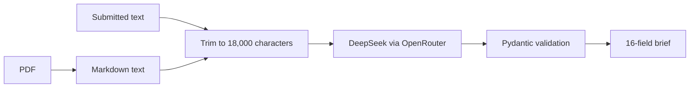

# ReqVue

ReqVue turns a request for quotation (RFQ) into a short, structured brief for
the person deciding whether to bid. Instead of searching a long procurement
document for deadlines, materials, quantities, and contract risks, an estimator
can review those details together. The original document still needs human review.

## How it works

1. Submit a text-based PDF or paste its text into `POST /parse`.
2. PyMuPDF converts the PDF to Markdown. A heuristic keeps up to 18,000 characters,
   prioritizing specifications, delivery requirements, and commercial risks.
3. DeepSeek through OpenRouter extracts a 16-field brief. Pydantic validates the
   structure; fields without supported information should be `null`.
4. The API runs extraction in a background task. Poll `GET /status/{job_id}` for
   the completed brief or an error.



## Tech stack

- Python 3.12, FastAPI, and Uvicorn
- PyMuPDF and pymupdf4llm for PDF text extraction
- OpenAI Python SDK connecting to OpenRouter; model: `deepseek/deepseek-v4-flash`
- Pydantic for response validation; python-dotenv for local API-key configuration
- Docker deployment configuration

## Quick start

Use Python 3.12 and an OpenRouter account with credit and access to the configured
model. Extraction sends document text to the external provider and may incur costs.

```bash
git clone --branch portfolio-cleanup https://github.com/msanchez78158/reqvue-api.git
cd reqvue-api
python3.12 -m venv .venv
source .venv/bin/activate
python -m pip install -r requirements.txt
cp .env.example .env
```

Edit `.env` locally and replace `your_openrouter_api_key` with your own key.
`.env` is ignored by Git. The only required variable is `OPENROUTER_API_KEY`.
Never put a real key in `.env.example`, source files, or commits.

Start one server worker:

```bash
python -m uvicorn main:app --host 127.0.0.1 --port 8000
```

In another terminal:

```bash
curl http://127.0.0.1:8000/health
```

The health response is `{"status":"ok"}`; it does not test the LLM provider.
Interactive API documentation is at `http://127.0.0.1:8000/docs`.

Optional settings in `.env.example`:

| Variable | Default | Usage |
| --- | --- | --- |
| `OPENROUTER_TIMEOUT_SECONDS` | `90` | Export it in the shell before starting the server to change the per-request LLM timeout. |
| `PORT` | `8000` | Used by the Docker startup command. For local Uvicorn, change `--port` explicitly. |

For example, `export OPENROUTER_TIMEOUT_SECONDS=120` before starting Uvicorn
changes the timeout. The timeout is read when the extractor module is imported,
before the app loads `.env`.

## Example request and response

Submit text (this example is fictional):

```bash
curl -X POST http://127.0.0.1:8000/parse \
  -H 'Content-Type: application/json' \
  -d '{"text":"Demo Fabrication RFQ DEMO-001. Quote 100 aluminum 6061 brackets, part DEMO-PART-001. FOB Destination. ISO 9001 certification required."}'
```

Or upload a retained PDF fixture:

```bash
curl -X POST http://127.0.0.1:8000/parse \
  -F 'file=@Testing/SPE8E426T1829.PDF'
```

Both return a job identifier immediately:

```json
{
  "job_id": "a1b2c3d4-1111-4222-8333-123456789abc",
  "status": "processing"
}
```

Use the returned identifier to poll:

```bash
curl http://127.0.0.1:8000/status/a1b2c3d4-1111-4222-8333-123456789abc
```

An illustrative completed response for the fictional text above is shown below.
LLM wording can vary; this is an example, not a recorded test result.
`pages_processed` is additional metadata: a PDF page count, or `null` for text input.

```json
{
  "job_id": "a1b2c3d4-1111-4222-8333-123456789abc",
  "status": "complete",
  "result": {
    "rfq_id_and_org": "DEMO-001 — Demo Fabrication",
    "quote_due_date": null,
    "delivery_deadline": null,
    "part_number_rev": "DEMO-PART-001",
    "material_and_grade": "Aluminum 6061",
    "dimensions_raw": null,
    "tolerances_stated": null,
    "finishing_secondary": null,
    "qty_tiers": null,
    "incoterms_fob": "FOB Destination",
    "target_price": null,
    "legal_penalties": null,
    "qa_certs_required": "ISO 9001",
    "competing_vendors": null,
    "missing_or_unclear": "Quote deadline, delivery schedule, dimensions, tolerances, and finishing requirements are not stated.",
    "estimator_summary": "Request for 100 aluminum brackets. Confirm missing specifications and schedule before quoting.",
    "pages_processed": null
  }
}
```

`qty_tiers` is for price-break quantities, not every order quantity.
A failed job returns `{"job_id":"...","status":"failed","error":"..."}`.
An unknown job identifier returns HTTP 404.

## Verification

Run focused API checks without sending requests to an LLM provider:

```bash
python -m unittest discover -s tests -v
```

To exercise real extraction against a running local server, use the existing
verification script. This sends the retained PDFs to the provider and can incur
costs; its field assertions depend on model output.

```bash
python verify_deploy.py http://127.0.0.1:8000
```

## Project structure

```text
main.py                  API routes, uploads, background jobs, and CORS
extractor.py             LLM request and validation of the 16-field brief
trimmer.py               Heuristic selection of document text
models.py                Response schemas
verify_deploy.py         PDF extraction checks against a running server
Testing/                 Two retained procurement PDF fixtures
tests/                   Offline API regression checks
docs/REQVUE_STATUS.md     Technical notes and limitations
```

## Known limitations

- No OCR: scanned and image-only PDFs are rejected when too little embedded text
  is available. Information contained only in drawings or images is not extracted.
- Trimming can omit relevant details. LLM output can be incomplete or wrong even
  when the JSON passes validation; confirm bid-critical facts in the source.
- PDF files and complete JSON request bodies each have a 25 MiB limit. Oversized
  input returns HTTP 413; the JSON limit includes syntax and all submitted fields.
- Jobs live in process memory, disappear on restart, and have no automatic
  eviction. Use a single worker/instance; there is no durable job queue.
- The API has no authentication or rate limiting. CORS allows only
  `https://redomaworks.com` and `https://www.redomaworks.com`; CORS restricts
  browsers and does not prevent direct API requests. Other browser origins,
  including local frontend development servers, are not allowed.
- Extraction depends on OpenRouter availability, model access, and account credit.
  A timeout or provider failure can fail a job. Document text goes to the provider.
- `/parse/v2` remains experimental and requires the optional `agno` dependency,
  which is not installed by the production requirements. Use `/parse`.

See [technical status notes](docs/REQVUE_STATUS.md) for additional context.
